<div align="center">



<br>


</div>

> [!NOTE]
> **Status: in development.** The data pipeline, models, and evaluation plan are defined below. Experiments are pending; validation scores and example predictions will be added after training.

**Project author:** Tejas Prashant Vanjari

## Overview

Visual Question Answering (VQA) combines computer vision and natural language processing to answer questions about images. This project investigates one specific question:

> **How much does seeing the image improve the answer, compared with reading the question alone?**

To isolate the effect of the image, the project trains two models that share everything except visual input:

| | Question-only baseline | Image + question model |
| --- | :---: | :---: |
| Reads the question | ✅ | ✅ |
| Sees the image | — | ✅ |
| Answer vocabulary | shared | shared |
| Validation examples | shared | shared |

Any gap between their scores is the measurable value of seeing the image.

For example, given the question *“What color is the car?”*, a question-only model can only guess a common color. The multimodal model receives the same question along with the image and can use visual features to predict the answer.

## Table of Contents

1. [Dataset and Preprocessing](#dataset-and-preprocessing)
2. [Model Architecture](#model-architecture)
3. [Evaluation and Results](#evaluation-and-results)
4. [Streamlit Demo](#streamlit-demo)
5. [Limitations](#limitations)
6. [Roadmap](#roadmap)
7. [References](#references)
8. [Acknowledgments](#acknowledgments)

## Dataset and Preprocessing



The project will use [VQA v2](https://visualqa.org/download.html), which pairs images from [MS COCO](https://cocodataset.org) with natural-language questions and answers from human annotators.

1. **Load a sample.** Start with a small subset of VQA v2 before scaling up.
2. **Verify pairing.** Check that each question is paired with the correct image and annotations.
3. **Build the answer vocabulary.** Count answers in the training data only and keep the most frequent ones. Both models predict from this same vocabulary.
4. **Encode inputs.** Preprocess images for ViT and tokenize questions for DistilBERT.
5. **Cache embeddings.** Run the frozen encoders once and store their outputs (see [Model Architecture](#model-architecture)).

The official training and validation splits stay separate throughout: the vocabulary and both classifiers are built from training data only.

<details>
<summary><b>VQA v2 at a glance</b></summary>
<br>

| Official split | Images (MS COCO 2014) | Questions | Human answers per question |
| --- | ---: | ---: | ---: |
| Train | 82,783 | 443,757 | 10 |
| Validation | 40,504 | 214,354 | 10 |

These are the full official splits. This project starts with a sample, and the final report will state the sample sizes and selection method.

</details>

## Model Architecture



| Model | Inputs | Planned architecture |
| --- | --- | --- |
| Question-only baseline | Question | DistilBERT text embedding → answer classifier |
| Image + question model | Image and question | ViT image embedding + DistilBERT text embedding → concatenation → answer classifier |

**Frozen encoders, cached embeddings.** The first version will use frozen pretrained encoders and train only the answer classifiers. Because the encoders don't change during training, their embeddings can be computed once and cached, which makes it possible to test classifier changes without repeatedly running both encoders.

## Evaluation and Results

Both models will be evaluated on the same validation examples using the [official VQA metric](https://visualqa.org/evaluation.html), which compares each prediction with the answers from multiple human annotators. After answers are normalized (case, punctuation, articles, and number words), a prediction earns full credit when at least three annotators gave the same answer:

```math
\text{Acc}(a) = \min\left(\frac{\text{number of annotators who answered } a}{3},\ 1\right)
```

The official evaluation averages this score over every subset of 9 of the 10 annotators.

**What will be reported**

- Overall scores, plus a breakdown by answer type: **yes/no**, **number**, and **other**.
- The *image gain*: the difference between the two models, overall and for each answer type.
- Error analysis covering cases where the image helped, cases where both models relied on common answers, and cases where the expected answer was outside the vocabulary.

### Same question, different image



One qualitative test uses the same question with two different images. For example, I’ll ask *“What color is the car?”* about a red car and a blue car to see whether the multimodal model changes its prediction appropriately. The question-only baseline acts as a built-in control: its input is identical in both cases, so its answer cannot change.

VQA v2 itself was built around this idea. Many of its questions are paired with a similar image that has a different answer, which limits how far a model can get from the question alone.

### Results

> [!IMPORTANT]
> Experiments are pending. Validation scores and example predictions will be added after training and evaluation.

| Model | Overall | Yes/No | Number | Other |
| --- | :---: | :---: | :---: | :---: |
| Question-only baseline | — | — | — | — |
| Image + question model | — | — | — | — |
| **Image gain (Δ)** | — | — | — | — |

## Streamlit Demo

The planned demo will let users upload an image, enter a question, and see predictions from both models side by side. This will make it easy to try the same question on different images or ask several questions about the same image.

## Limitations

- **Fixed answer vocabulary.** The classifiers can only predict answers included in the training vocabulary.
- **Answer frequency bias.** Both models may favor common answers, especially when the question follows a familiar pattern.
- **Fine visual details.** A single image embedding may miss small objects, spatial relationships, or details needed for counting.
- **Dataset scope.** Results from a small subset will reflect that subset. The final report will state the sample sizes and selection method.

## Roadmap

- [ ] Verify image, question, and answer loading on a small VQA v2 sample.
- [ ] Train the question-only baseline.
- [ ] Add ViT image features and train the multimodal classifier.
- [ ] Compare both models and document their errors.
- [ ] Build the Streamlit demo and add reproducible setup instructions.

## References

<details>
<summary><b>Papers behind the datasets and models</b></summary>
<br>

- Goyal, Y., Khot, T., Summers-Stay, D., Batra, D., & Parikh, D. (2017). *Making the V in VQA Matter: Elevating the Role of Image Understanding in Visual Question Answering.* CVPR.
- Antol, S., Agrawal, A., Lu, J., Mitchell, M., Batra, D., Zitnick, C. L., & Parikh, D. (2015). *VQA: Visual Question Answering.* ICCV.
- Lin, T.-Y., Maire, M., Belongie, S., Hays, J., Perona, P., Ramanan, D., Dollár, P., & Zitnick, C. L. (2014). *Microsoft COCO: Common Objects in Context.* ECCV.
- Dosovitskiy, A., Beyer, L., Kolesnikov, A., et al. (2021). *An Image Is Worth 16x16 Words: Transformers for Image Recognition at Scale.* ICLR.
- Sanh, V., Debut, L., Chaumond, J., & Wolf, T. (2019). *DistilBERT, a distilled version of BERT: smaller, faster, cheaper and lighter.* arXiv:1910.01108.

</details>

## Acknowledgments

I acknowledge **Professor Dipanjan Saha**, who teaches **EECE/CS 5639 Computer Vision** at **Northeastern University**, where I serve as a teaching assistant.

I also acknowledge the creators of VQA v2 and MS COCO for the datasets used in this project.
